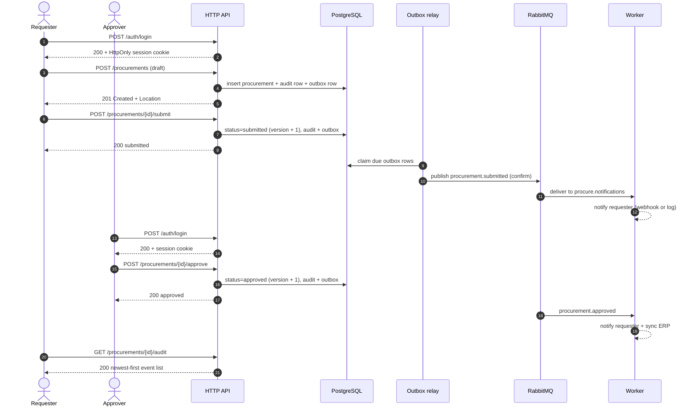
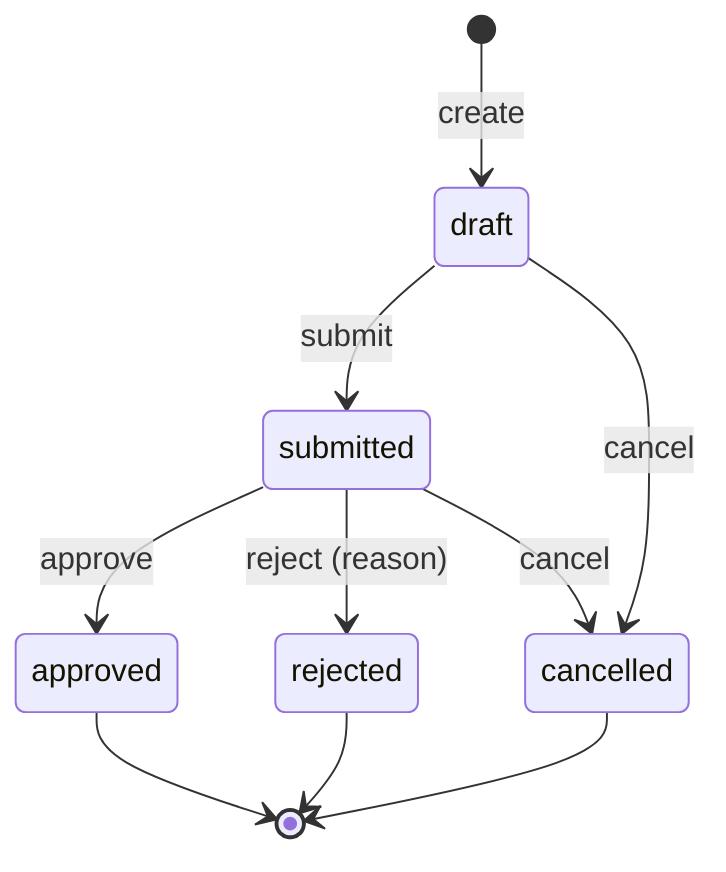

# User journeys

This document follows the people who use procure-flow: what they can do, in
what order, and what the system writes or emits at each step. It complements the
[API walkthrough](../README.md#walkthrough) and the
[architecture](architecture.md) notes.

All paths are under `/api/v1`. Errors use RFC 9457 `application/problem+json`
with a stable `code` field.

## Cast

| Persona | Role | Scope | Typical job |
| --- | --- | --- | --- |
| Requester | `requester` | Their own requests | Raise a purchase request and shepherd it to submission |
| Approver | `approver` | Requests in their department | Approve or reject submitted requests |
| Viewer | `viewer` | Read-only | Audit history and reporting |
| Admin | `admin` | Everything | Unblock requests, cover for approvers, test the system |

Ownership is stored as `requester_id`, derived from the authenticated subject.
The `requester` field in the request body is only a display label; it cannot
change ownership. Any authenticated actor may read any request — there is no
per-record ACL — which is acceptable for an internal procurement service but is
a documented limitation if you expose it to multiple tenants.

| Action | `requester` | `approver` | `viewer` | `admin` |
| --- | --- | --- | --- | --- |
| Create draft | Yes | No | No | Yes |
| Read / list / audit | Yes | Yes | Yes | Yes |
| Submit | Own requests only | No | No | Yes |
| Approve / reject | No | Own department, not own request | No | Yes, any request, including own |
| Cancel | Own requests only | No | No | Yes |

Submitting requires a recorded owner: legacy or imported rows with an empty
`requester_id` can only be moved by an admin. Cancel works on `draft` and
`submitted`.

## Getting in: sessions

The API has no anonymous traffic. Every route except login and logout requires a
session cookie or a bearer credential.

1. An admin seeds or provisions accounts (`make seed`, the compose `seed`
   service, or `POST`-less SQL/your identity tooling). Passwords are stored as
   bcrypt hashes.
2. The user posts their email and password to `/api/v1/auth/login`.
3. The API verifies the password, signs an HS256 JWT carrying `sub`, `name`,
   `email`, `roles`, and `department`, and returns it as an `HttpOnly` cookie
   scoped to `/api/v1`. The token never appears in the response body.
4. The browser sends the cookie automatically. Scripts may continue to use
   `Authorization: Bearer <token>` with a static API key or an externally issued
   JWT.
5. `/api/v1/auth/logout` clears the cookie. The token is stateless, so a copied
   token stays valid until `AUTH_SESSION_TTL` (8h by default) expires.

```bash
curl -s -c cookies.txt -X POST http://localhost:8080/api/v1/auth/login \
  -H 'Content-Type: application/json' \
  -d '{"email":"requester@procure.local","password":"demo-password-123"}'

curl -s -b cookies.txt http://localhost:8080/api/v1/auth/me
```

The seeded development accounts are `admin@`, `approver@`, `requester@`, and
`viewer@procure.local`, all with `demo-password-123` outside production.

## The main journey: draft to approved



### 1. Create a draft

`POST /api/v1/procurements` accepts a title, department, amount in minor units,
and a three-letter currency. The service:

- rejects callers without the `requester` or `admin` role (`403 FORBIDDEN`);
- derives `requester_id` from the token;
- generates `prc_…` and `PR-YYYYMM-…` identifiers with retry on the tiny chance
  of a collision;
- validates the aggregate (`422 VALIDATION_ERROR` with per-field messages);
- writes the procurement and its `procurement.created` audit row in one
  PostgreSQL transaction, plus an outbox row when async events are enabled;
- returns `201`, a `Location` header, and the aggregate.

```bash
ID=$(curl -s -b requester.txt -X POST http://localhost:8080/api/v1/procurements \
  -H 'Content-Type: application/json' \
  -H 'Idempotency-Key: demo-create-1' \
  -d '{"title":"Laptop procurement for engineering","department":"Engineering",
       "requester":"Amir","amount":250000000,"currency":"IDR"}' | jq -r '.data.id')
```

The optional `Idempotency-Key` makes this step retry-safe; see
[retries and conflicts](#retries-conflicts-and-replays).

### 2. Find and submit

The requester (`draft` owner) or an admin calls
`POST /api/v1/procurements/{id}/submit`. The aggregate must currently be
`draft`, otherwise the call fails with `409 INVALID_TRANSITION`.

On success the row moves to `submitted`, its `version` increments, an audit row
records `draft → submitted`, and an outbox row is queued for
`procurement.submitted`. The response is the updated aggregate.

Lists support `q`, `status`, `page`, and `page_size` (maximum 100). Readers see
every request; `q` searches title, description, number, department, and
requester.

### 3. Approve

An approver whose `department` matches the request, or an admin, calls
`POST /api/v1/procurements/{id}/approve` on a `submitted` request. The service
checks:

- the caller holds `approver` or `admin`;
- the request is still `submitted` (`409` otherwise);
- the approver's department matches (case-insensitive; empty departments do not
  match);
- a non-admin approver is not the recorded requester (`403`), enforcing
  segregation of duties;
- the stored `version` still equals the one read at the start of the request,
  otherwise `409 CONFLICT` because someone else moved it first.

Approval clears any previous rejection reason, bumps `version`, writes the audit
row, and queues `procurement.approved`.

### 4. Read and audit

`GET /api/v1/procurements/{id}` is cache-aside: the first read loads from
PostgreSQL and stores JSON in Redis; writes invalidate the key after commit.
`GET /api/v1/procurements/{id}/audit` returns append-only events newest first
with `meta.page`, `meta.page_size`, `meta.total`, and `meta.total_pages`.

Every mutation also invalidates the cached aggregate, so a reader immediately
after a write sees the new status.

### 5. Side effects

When `RABBITMQ_URL` is configured, an outbox relay inside the API publishes the
event to the `procure.events` topic exchange with publisher confirms. The worker
consumes two durable queues:

- `procure.notifications` binds every lifecycle event and notifies the requester
  (webhook when `NOTIFICATION_WEBHOOK_URL` is set, otherwise a log line);
- `procure.integrations` binds `procurement.approved` and syncs the approved
  purchase with the ERP (`ERP_WEBHOOK_URL`, otherwise a log line).

Delivery is at-least-once. Every payload includes `event_id` so consumers can
deduplicate redeliveries. Without a broker URL no outbox rows are written at all.

## Alternate journeys

### Rejection

An approver rejects a submitted request with a reason of 3–500 characters:

```bash
curl -s -b approver.txt -X POST \
  http://localhost:8080/api/v1/procurements/$ID/reject \
  -H 'Content-Type: application/json' \
  -d '{"reason":"Budget is frozen until next quarter"}'
```

The status becomes `rejected`, the reason is stored on the aggregate and
returned as `rejection_reason`, and `procurement.rejected` is emitted. Rejected
requests are terminal: they cannot be re-submitted; the requester creates a new
one.

### Cancellation

The owner or an admin may cancel a `draft` or `submitted` request. Cancelling a
submitted request removes it from the approval queue without a decision and
emits `procurement.cancelled`. Approved and rejected requests cannot be
cancelled.

### Admin override

Admins bypass department and ownership checks, including approving their own
requests. This is deliberate: it gives operators a way out of a stuck approval
without editing the database. The audit trail still records who acted, and the
admin role should be treated as break-glass.

### Viewer / reporting

Viewers can list, read, and paginate audit trails, but every mutation returns
`403 FORBIDDEN`. Combined with `status` filters, this is enough for a reporting
UI without granting write access.

### Retries, conflicts, and replays

| Situation | Result |
| --- | --- |
| Same `Idempotency-Key` and body, first request succeeded | `200/201` replayed, `Idempotent-Replayed: true` |
| Same key, different body | `422 IDEMPOTENCY_KEY_REUSED` |
| Same key while the first request is still running | `409 IDEMPOTENCY_IN_PROGRESS`, `Retry-After: 1` |
| First response was a 5xx | Claim released, the client may retry |
| Two actors change the same request | One wins; the other gets `409 CONFLICT` and should re-read |
| Action not allowed for the current status | `409 INVALID_TRANSITION` |
| Action not allowed for the caller | `403 FORBIDDEN` |
| Missing or expired session | `401 UNAUTHENTICATED` |
| Wrong email or password | `401 INVALID_CREDENTIALS` |
| Too many requests | `429 RATE_LIMITED` with `Retry-After` |
| Invalid body or field | `422 VALIDATION_ERROR` with `errors` |
| Unknown id | `404 NOT_FOUND` |

### Session expiry

The session cookie expires after `AUTH_SESSION_TTL`. The next API call returns
`401 UNAUTHENTICATED`; the client sends the user to the login screen and retries
the action. Because the JWT is stateless, logout only removes the cookie from
the browser — revoking a leaked token requires rotating `AUTH_JWT_SECRET` or
introducing server-side session storage.

## Lifecycle



## What the system records

| Step | Tables written | Events emitted | Cache |
| --- | --- | --- | --- |
| Login | none | none | none |
| Create | `procurements`, `audit_events`, `outbox_events`* | `procurement.created` | none |
| Submit | `procurements`, `audit_events`, `outbox_events`* | `procurement.submitted` | invalidated |
| Approve | `procurements`, `audit_events`, `outbox_events`* | `procurement.approved` | invalidated |
| Reject | `procurements`, `audit_events`, `outbox_events`* | `procurement.rejected` | invalidated |
| Cancel | `procurements`, `audit_events`, `outbox_events`* | `procurement.cancelled` | invalidated |
| Read by id | none (may fill `redis`) | none | filled |

\* Outbox rows are written only when `RABBITMQ_URL` is configured; without a
broker there is nothing to relay and no rows accumulate.

The audit trail is append-only: a PostgreSQL trigger rejects `UPDATE` and
`DELETE` on `audit_events`, so history survives even a buggy application.

## Where to go next

- [Architecture](architecture.md) — layers, transaction boundaries, failure
  modes.
- [Technology](technology.md) — what PostgreSQL, Redis, RabbitMQ, and the rest
  are doing here.
- [Configuration](configuration.md) — every environment variable.
